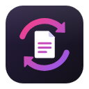

<p align="center"></p>

# LocalConvert : convertisseur de fichiers hors ligne (C# / .NET 8)

*[English version](README.md)*

Application de bureau pour **Windows, macOS et Linux** (Avalonia) et outil en ligne de commande qui regroupe les conversions qu'on fait d'habitude sur des sites web. Tout se passe sur l'ordinateur : **aucun fichier n'est envoyé sur Internet**.

Elle permet de :

- **créer un PDF à partir d'une ou plusieurs images** (une page par image, TIFF multipage pris en charge) ;
- **modifier un PDF** : supprimer des pages, en ajouter (depuis d'autres PDF ou des images), les réorganiser, les faire pivoter ;
- **fusionner plusieurs PDF** (et images) en un seul document ;
- **compresser un PDF** (scans, documents pleins de photos) en réduisant ses images, sans toucher au texte ;
- **découper un PDF** : une page par fichier, toutes les N pages ou selon des plages (« 1-3, 4-7, 8- ») ;
- **convertir un PDF en images** (PNG, JPEG, WebP, BMP, GIF, TIFF, résolution au choix) ;
- **convertir un PDF en Word, ODT ou texte** (.docx, .odt, .txt) : texte, paragraphes, titres et gras, sans la mise en page exacte ;
- **convertir des images d'un format à un autre** (PNG, JPEG, WebP, AVIF, BMP, GIF, TIFF), avec redimensionnement optionnel. Les photos **HEIC** des iPhone sont lues partout (conversion, images → PDF) ;
- **convertir des sons** en MP3, WAV, AIFF, FLAC, OGG, Opus ou M4A (et extraire le son d'une vidéo) ;
- **convertir des vidéos** en MP4, MKV, WebM, AVI, OGG, MOV ou **GIF animé** (qualité, résolution maximale, suppression du son, changement de conteneur sans réencodage) ;
- **couper un extrait** d'un son ou d'une vidéo (début et fin) ;
- **extraire les images d'une vidéo** en PNG ou JPEG : toutes, ou à intervalle régulier (1 par seconde…), sur toute la vidéo ou entre deux positions.

Les fichiers d'origine ne sont jamais modifiés, sauf si vous choisissez vous-même de les écraser.

L'application et la ligne de commande sont disponibles en **français, anglais, allemand et espagnol**. La langue du système est
choisie automatiquement (l'anglais si elle n'est pas proposée) ; on peut la changer en haut à droite de la fenêtre, et ce choix
est retenu. En ligne de commande : option `--lang fr|en|de|es` ou variable d'environnement `LOCALCONVERT_LANG`.

### Traductions

Le texte français sert de clé : dans le code, `L.T("Ajouter des images")` (ou `L.T("{0} page(s)", n)` avec des valeurs) ;
dans les fichiers `.axaml`, les textes écrits en dur sont traduits automatiquement au chargement de la fenêtre. Les traductions
sont dans `src/AllInOne.Core/Localization/en.json`, `de.json` et `es.json`. Le test `LocalizationTests` échoue si un texte
du code ou des écrans n'a pas de traduction dans l'une des langues, ou si les marqueurs `{0}`… ne correspondent pas.

## Structure

| Projet | Rôle |
| --- | --- |
| `src/AllInOne.Core` | Bibliothèque multiplateforme qui contient toute la logique (utilisable depuis n'importe quel programme .NET). |
| `src/AllInOne.App` | Application de bureau [Avalonia](https://avaloniaui.net/) (Windows, macOS, Linux), une page par outil. |
| `src/AllInOne.Cli` | Outil en ligne de commande `localconvert-cli` (Windows, Linux, macOS). |
| `tests/AllInOne.Core.Tests` | Tests automatisés (xUnit). |

## Utiliser l'application de bureau

Prérequis : Windows 10/11, macOS 12 ou plus récent, ou Linux x64, et le [SDK .NET 8](https://dotnet.microsoft.com/download/dotnet/8.0).

```powershell
dotnet run --project src/AllInOne.App
```

Pour obtenir un dossier prêt à copier (`LocalConvert.exe` avec ses DLL à côté) :

```powershell
dotnet publish src/AllInOne.App -c Release -o publish
```

La compilation produit volontairement **plusieurs fichiers** (exe + DLL) plutôt qu'un seul exe géant. Ajoutez `-r win-x64`,
`-r osx-arm64`, `-r osx-x64` ou `-r linux-x64` pour ne garder que les bibliothèques natives d'un système. Par défaut, elle dépend du runtime .NET installé ; ajoutez `--self-contained true` pour
embarquer .NET (dossier environ 4 fois plus lourd, mais rien à installer).

**Releases automatiques :** à chaque fusion d'une pull request dans `main`, le workflow `release` publie une
[release GitHub](../../releases) numérotée `v1.0.N` (N s'incrémente à chaque fois). Chaque archive contient l'application `LocalConvert`, la ligne de commande
`localconvert-cli` et leurs bibliothèques :

| Archive | Système | Prérequis |
| --- | --- | --- |
| `LocalConvert-<version>-win-x64.zip` (légère) | Windows 10/11 | [.NET 8 Runtime](https://dotnet.microsoft.com/download/dotnet/8.0) (Windows propose de l'installer au premier lancement s'il manque) |
| `LocalConvert-<version>-win-x64-autonome.zip` | Windows 10/11 | aucun |
| `LocalConvert-<version>-macos-apple-silicon.zip` | Mac M1, M2, M3, M4… (macOS 12+) | aucun |
| `LocalConvert-<version>-macos-intel.zip` | Mac Intel (macOS 12+) | aucun |
| `LocalConvert-<version>-linux-x64.tar.gz` | Linux x64 | aucun (bibliothèques graphiques X11 habituelles d'un bureau) |

Sur macOS, `LocalConvert.app` est signée « ad hoc » mais pas par Apple (il faudrait un compte développeur payant) : à la première
ouverture, macOS la bloque. Allez dans **Réglages Système → Confidentialité et sécurité → Ouvrir quand même** (ou, avant
macOS Sequoia, clic droit sur l'app → **Ouvrir**). En ligne de commande : `xattr -dr com.apple.quarantine /Applications/LocalConvert.app`.

L'essentiel du poids restant vient des moteurs natifs : ImageMagick (≈ 25 Mo), SkiaSharp (≈ 12 Mo) et PDFium (≈ 7 Mo).

L'interface a un thème sombre (dégradé rose → violet, cartes arrondies) avec une navigation latérale entre les outils :

1. **Images → PDF** : ajoutez ou glissez des images, ordonnez-les (glisser-déposer, Monter/Descendre, Trier par nom), choisissez la taille de page (A4, A3, A5, Lettre, Légal ou taille de l'image), l'orientation et la marge.
2. **Modifier / fusionner des PDF** : ouvrez un ou plusieurs PDF et/ou images ; toutes les pages s'affichent en vignettes. Sélectionnez-les pour les supprimer (touche Suppr), les pivoter, les déplacer ou glissez-les à la souris. Les fichiers ajoutés sont insérés après la page sélectionnée. « Enregistrer sous » produit le PDF final.
3. **Compresser un PDF** : ajoutez un ou plusieurs PDF et choisissez le niveau (légère 200 ppp, moyenne 150 ppp, forte 100 ppp). Les images sont réduites et recompressées en JPEG ; le texte et les dessins restent vectoriels. Chaque ligne montre la taille avant et après. Un PDF déjà optimisé est simplement copié.
4. **Découper un PDF** : une page par fichier, toutes les N pages, ou selon des plages où chaque plage donne un fichier (`1-3, 4-7, 8-`).
5. **PDF → images** : choisissez un PDF, les pages (ex. `1-3,5`, vide = toutes), le format, la résolution et la qualité.
6. **PDF → Word / texte** : récupérez le texte de vos PDF dans un document modifiable, Word (.docx), OpenDocument (.odt, LibreOffice) ou texte brut (.txt). Les paragraphes, les titres et le gras sont repris, une page du PDF par page. Les images, les tableaux et la mise en page exacte ne le sont pas ; un PDF scanné (pages en image) n'a pas de texte à récupérer, car il n'y a pas de reconnaissance de caractères (OCR).
7. **Convertir des images** : convertissez un lot d'images (dont HEIC) vers un autre format, avec largeur/hauteur maximales optionnelles.
8. **Vidéos et GIF** : ajoutez ou glissez des vidéos (ou des GIF), choisissez le format, dont le GIF animé, la qualité et la résolution maximale. Les champs Début et Fin gardent seulement un extrait (ex. de `1:30` à `2:45`). Les formats « Images PNG » et « Images JPEG » extraient les images de la vidéo (toutes, ou 1 par seconde, 1 toutes les 5 s…) dans un dossier `<nom>_images` ; au-delà d'environ 3 000 images, une confirmation est demandée. Un bouton « Arrêter » interrompt la conversion.
   Chaque ligne affiche les caractéristiques du fichier (durée, résolution, codecs, images/s, débit, taille) puis, pendant la conversion, sa propre barre de progression et le temps restant estimé. Un fichier en échec n'arrête pas les suivants.
9. **Convertir des sons** : MP3, WAV, AIFF, FLAC, OGG Vorbis, Opus ou M4A (AAC), avec qualité, fréquence d'échantillonnage et mono/stéréo. Les vidéos déposées ici donnent leur piste audio. Début et Fin permettent de couper un extrait. Comme pour les vidéos, chaque ligne montre durée, codec, débit, fréquence, canaux et taille, puis l'avancement et le temps restant.

### FFmpeg (conversion vidéo et audio)

Les conversions vidéo et audio utilisent [FFmpeg](https://ffmpeg.org/), lancé comme programme séparé. Il n'est **pas inclus** dans l'exe (il pèserait environ 200 Mo de plus) :
à la première conversion, l'application propose de le télécharger (build GPL de [BtbN/FFmpeg-Builds](https://github.com/BtbN/FFmpeg-Builds))
dans `%LOCALAPPDATA%\LocalConvert\ffmpeg`. Si FFmpeg est déjà installé (à côté de l'exe ou dans le `PATH`), il est utilisé directement.
Sur **macOS**, installez-le avec [Homebrew](https://brew.sh) (`brew install ffmpeg`) ; sur **Linux**, avec le gestionnaire de paquets
(`sudo apt install ffmpeg`, `sudo dnf install ffmpeg`, `sudo pacman -S ffmpeg`). L'application le trouve aussi dans
`/opt/homebrew/bin`, `/usr/local/bin` et `/usr/bin` même quand elle est lancée depuis le Finder.
La variable d'environnement `LOCALCONVERT_FFMPEG` permet d'indiquer un chemin précis.

| Format | Vidéo | Audio |
| --- | --- | --- |
| MP4, MKV, MOV | H.264 (libx264) | AAC |
| WebM | VP9 | Opus |
| AVI | MPEG-4 Part 2 (Xvid) | MP3 |
| OGG | Theora | Vorbis |

## Utiliser la ligne de commande

```bash
dotnet run --project src/AllInOne.Cli -- --help
```

Exemples (les pages sont numérotées à partir de 1) :

```bash
localconvert-cli images2pdf album.pdf photo1.jpg photo2.png --size A4 --margin 10
localconvert-cli merge tout.pdf partie1.pdf partie2.pdf annexe.png
localconvert-cli delete rapport.pdf 2,5-7 -o rapport_court.pdf
localconvert-cli reorder rapport.pdf 3,1,2 -o rapport_reordonne.pdf
localconvert-cli move rapport.pdf 5 1 -o rapport.pdf
localconvert-cli insert rapport.pdf 3 couverture.pdf schema.png -o rapport_complet.pdf
localconvert-cli rotate scan.pdf 1-2 90 -o scan_droit.pdf
localconvert-cli extract rapport.pdf 4-6 -o extrait.pdf
localconvert-cli split rapport.pdf pages/
localconvert-cli split rapport.pdf parties/ --ranges "1-3, 4-7, 8-"   # un fichier par plage
localconvert-cli split rapport.pdf paquets/ --every 10
localconvert-cli compress scan.pdf scan_leger.pdf --level forte
localconvert-cli pdf2img rapport.pdf images/ --format png --dpi 200 --pages 1-3
localconvert-cli pdf2doc sortie/ rapport.pdf contrat.pdf --format docx   # ou odt, txt
localconvert-cli convert sortie/ *.png --format webp --quality 85 --max-width 1920
localconvert-cli video sortie/ film.avi clip.mov --format mp4 --quality haute --max-height 1080
localconvert-cli video sortie/ film.mp4 --format mkv --copy        # changement de conteneur, sans réencodage
localconvert-cli audio sortie/ morceau.wav concert.aiff --format mp3 --quality haute
localconvert-cli audio sortie/ film.mp4 --format flac                # extrait le son d'une vidéo
localconvert-cli video sortie/ film.mp4 --format gif --start 0:12 --end 0:18 --quality faible
localconvert-cli frames sortie/ film.mp4 --format jpg --fps 1 --start 1:00 --end 2:00   # 1 image par seconde
localconvert-cli frames sortie/ clip.mov                                               # toutes les images, en PNG
localconvert-cli audio sortie/ concert.wav --format mp3 --start 1:30 --end 4:05
localconvert-cli convert sortie/ IMG_0001.HEIC IMG_0002.HEIC --format jpg
```

## Licence

LocalConvert est distribué sous [licence MIT](LICENSE).

## Bibliothèques utilisées et licences

Toutes les dépendances sont sous licence permissive, compatibles avec un usage personnel ou commercial :

| Bibliothèque | Usage | Licence |
| --- | --- | --- |
| [PDFsharp](https://github.com/empira/PDFsharp) 6.2.4 | Création et modification des PDF | MIT |
| [Avalonia](https://github.com/AvaloniaUI/Avalonia) | Interface graphique (Windows, macOS, Linux) | MIT |
| [PDFtoImage](https://github.com/sungaila/PDFtoImage) 5.2.1 | Rendu des pages PDF en images | MIT |
| [PDFium](https://pdfium.googlesource.com/pdfium/) (binaires bblanchon) | Moteur de rendu PDF utilisé par PDFtoImage | BSD-3 / Apache 2.0 |
| [SkiaSharp](https://github.com/mono/SkiaSharp) | Graphismes utilisés par Avalonia et PDFtoImage | MIT |
| [Magick.NET](https://github.com/dlemstra/Magick.NET) (ImageMagick) | Lecture et conversion des images | Apache 2.0 |
| [PdfPig](https://github.com/UglyToad/PdfPig) | Lecture du texte des PDF (PDF → Word, ODT, texte) | Apache 2.0 |
| [FFmpeg](https://ffmpeg.org/) (téléchargé à part, non inclus) | Conversion vidéo et audio | GPL (programme séparé) |

> **Attention :** PDFsharp est volontairement figé en version **6.2.4**. Les versions 6.5 et suivantes sont passées
> sous licence AGPL-3.0 avec une vérification de licence au démarrage. Ne mettez pas à jour ce paquet sans vérifier sa licence.
>
> PDFtoImage reste en **5.2.1**, qui utilise SkiaSharp 3 comme Avalonia 11 (la 5.4 passe à SkiaSharp 4,
> incompatible avec l'interface). Vérifiez la version de SkiaSharp avant de le mettre à jour.

FFmpeg est un programme indépendant, exécuté comme processus externe et téléchargé par l'utilisateur : il n'est ni lié ni
redistribué avec LocalConvert, dont la licence n'est donc pas affectée par la GPL de FFmpeg.

ImageSharp n'a pas été retenu car sa licence actuelle (Six Labors Split License) n'est pas totalement libre pour un usage commercial.

## Limites connues

- Les PDF protégés par mot de passe ne sont pas pris en charge pour la modification.
- Les versions macOS ne sont pas signées par Apple (voir plus haut pour les ouvrir).
- FFmpeg n'est téléchargé automatiquement que sous Windows ; sur macOS et Linux, il s'installe avec le gestionnaire de paquets.

## Tests

```bash
dotnet test
```
