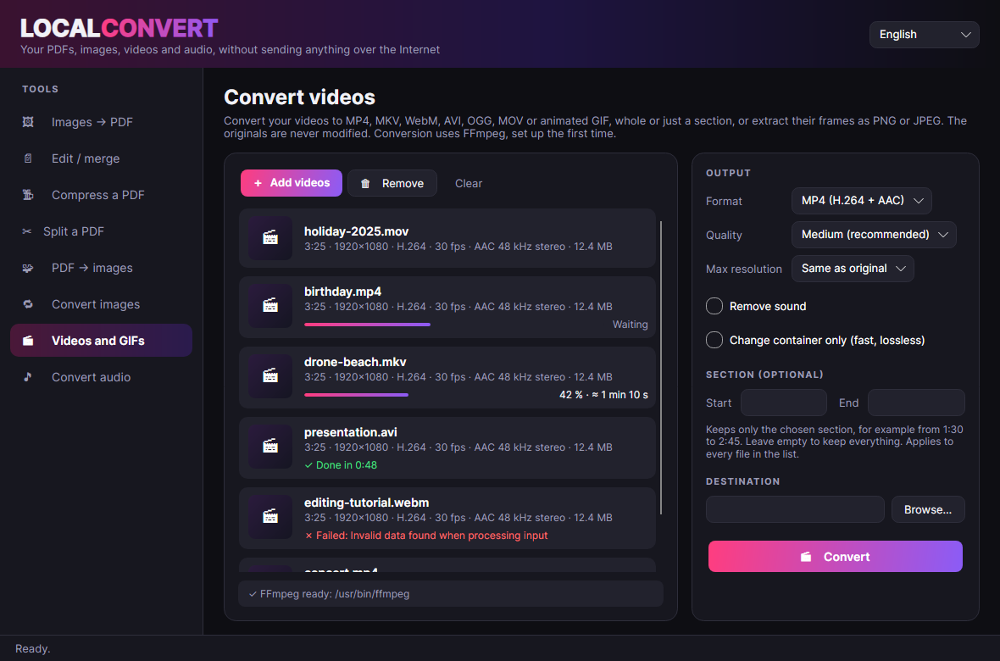
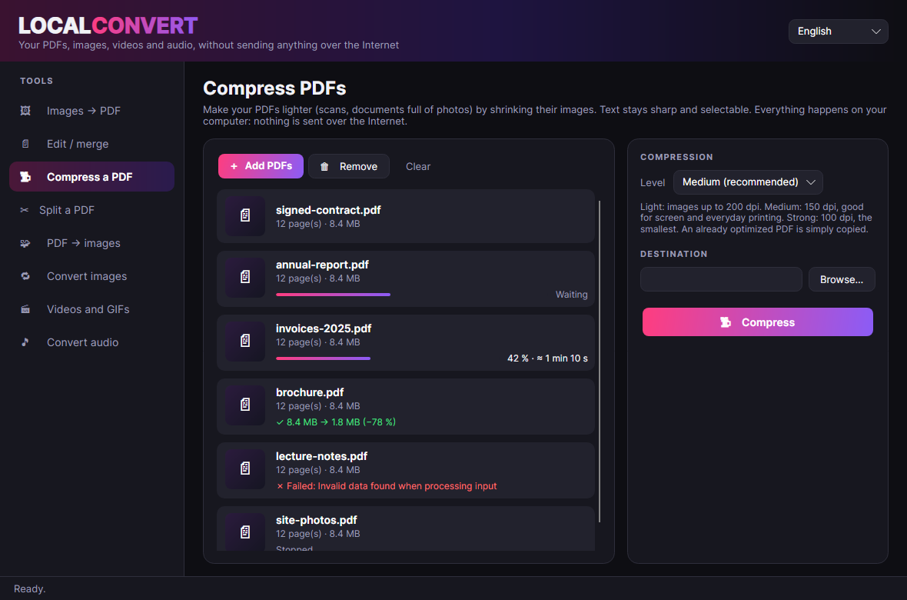
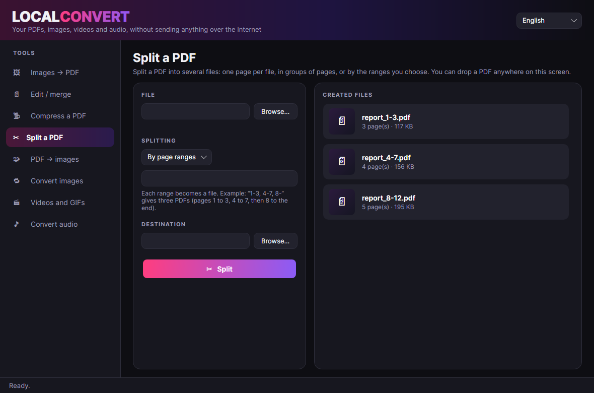
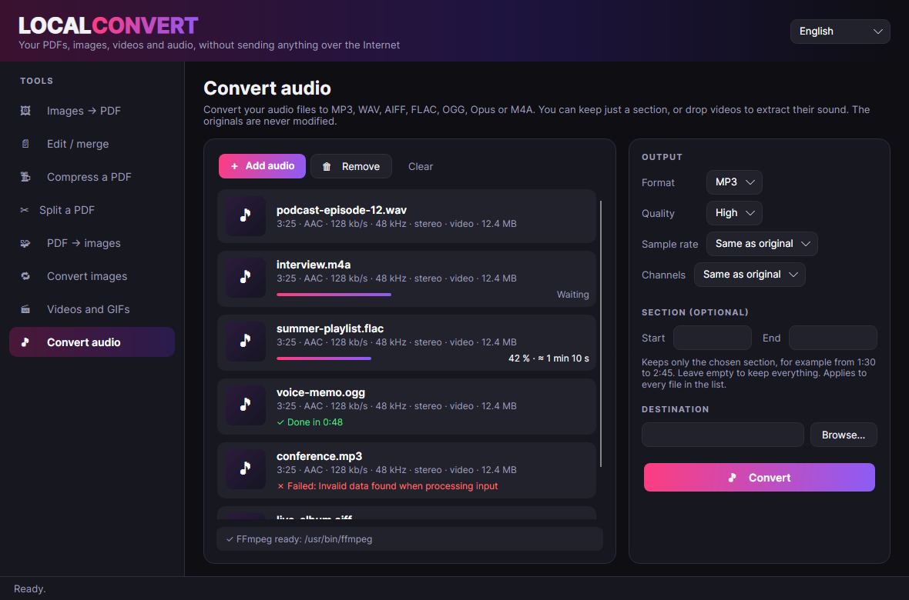

# LocalConvert: offline PDF, image, video and audio converter

*[Version française](README.fr.md)*

LocalConvert is a free desktop app for **Windows, macOS and Linux** that does the file conversions people usually do on
websites, **entirely on your computer**. Your files are never uploaded anywhere: no account, no cloud, no tracking.

The app is available in **English, French, German and Spanish**.



## Features

**PDF**
- **Images → PDF**: one page per image (multi-page TIFF supported), with page size, orientation and margin.
- **Edit and merge PDFs**: delete, add, reorder and rotate pages, and merge several PDFs and images into one document.
- **Compress PDFs**: shrink scanned or photo-heavy PDFs by downsampling their images. Text stays sharp and selectable.
- **Split PDFs**: one page per file, every N pages, or by ranges such as `1-3, 4-7, 8-`.
- **PDF → images**: PNG, JPEG, WebP, BMP, GIF or TIFF, at the resolution you choose.

**Images**
- **Convert images** between PNG, JPEG, WebP, AVIF, BMP, GIF and TIFF, with optional resizing.
- iPhone **HEIC** photos can be opened everywhere in the app.

**Video and audio** (uses [FFmpeg](https://ffmpeg.org/))
- **Convert videos** to MP4, MKV, WebM, AVI, OGG, MOV or **animated GIF**. You can set quality and maximum resolution, remove the sound, or change only the container without re-encoding.
- **Convert audio** to MP3, WAV, AIFF, FLAC, OGG, Opus or M4A, and extract the sound from videos.
- **Trim** a section (start and end) of any video or audio file.
- **Extract frames** from a video as PNG or JPEG, either every frame or one every N seconds, over the whole video or between two positions.
- Each file shows its details (duration, resolution, codecs, bitrate, size), its own progress bar and an estimate of the time left.

Your original files are never modified.

| Compress PDFs | Split a PDF | Convert audio |
| --- | --- | --- |
|  |  |  |

## Download

Get the latest version from the [Releases page](../../releases/latest).

| File | System | Requirements |
| --- | --- | --- |
| `LocalConvert-<version>-win-x64.zip` | Windows 10/11 (light) | [.NET 8 Runtime](https://dotnet.microsoft.com/download/dotnet/8.0); Windows offers to install it on first launch |
| `LocalConvert-<version>-win-x64-autonome.zip` | Windows 10/11 (standalone) | none |
| `LocalConvert-<version>-macos-apple-silicon.zip` | Mac with M1, M2, M3, M4… (macOS 12+) | none |
| `LocalConvert-<version>-macos-intel.zip` | Mac with Intel processor (macOS 12+) | none |
| `LocalConvert-<version>-linux-x64.tar.gz` | Linux x64 | none (the usual X11 desktop libraries) |

- **Windows:** unzip the archive and run `LocalConvert.exe`.
- **macOS:** unzip the archive and drag **LocalConvert.app** into Applications. The app is not signed by Apple, which
  requires a paid developer account, so macOS blocks it the first time. Try to open it once, then go to
  **System Settings → Privacy & Security** and click **Open Anyway**. On macOS versions before Sequoia, right-click the app
  and choose **Open** instead. From Terminal, you can also run
  `xattr -dr com.apple.quarantine /Applications/LocalConvert.app`.
- **Linux:** run `tar -xzf LocalConvert-<version>-linux-x64.tar.gz`, then run `./LocalConvert` in the extracted folder.

### FFmpeg (video and audio)

Video and audio conversions use FFmpeg, which runs as a separate program. It is not bundled with the app, because it
would add about 200 MB.

- **Windows:** the app offers to download it on your first conversion (a GPL build from
  [BtbN/FFmpeg-Builds](https://github.com/BtbN/FFmpeg-Builds)).
- **macOS:** install it with [Homebrew](https://brew.sh): `brew install ffmpeg`.
- **Linux:** install it with your package manager: `sudo apt install ffmpeg` (Debian, Ubuntu), `sudo dnf install ffmpeg`
  (Fedora) or `sudo pacman -S ffmpeg` (Arch).

If FFmpeg is already installed (next to the app or in the `PATH`), the app uses it. You can also give an exact path in
the `LOCALCONVERT_FFMPEG` environment variable.

## Language

LocalConvert starts in your system language, or in English if that language isn't available. You can change it in the
top-right corner of the window, and the app remembers your choice. On the command line, use `--lang en|fr|de|es` or set the
`LOCALCONVERT_LANG` environment variable.

## Command line

Each archive also includes `localconvert-cli`, a command-line version of the PDF, image, video and audio tools:

```bash
localconvert-cli images2pdf album.pdf photo1.jpg photo2.png --size A4 --margin 10
localconvert-cli merge all.pdf part1.pdf part2.pdf appendix.png
localconvert-cli delete report.pdf 2,5-7 -o short_report.pdf
localconvert-cli split report.pdf parts/ --ranges "1-3, 4-7, 8-"
localconvert-cli compress scan.pdf scan_small.pdf --level strong
localconvert-cli pdf2img report.pdf images/ --format png --dpi 200 --pages 1-3
localconvert-cli convert out/ *.png --format webp --quality 85 --max-width 1920
localconvert-cli video out/ movie.avi clip.mov --format mp4 --quality high --max-height 1080
localconvert-cli video out/ movie.mp4 --format gif --start 0:12 --end 0:18 --quality low
localconvert-cli audio out/ movie.mp4 --format flac            # extract the sound of a video
localconvert-cli frames out/ movie.mp4 --format jpg --fps 1 --start 1:00 --end 2:00
```

Run `localconvert-cli --help` for every command and option.

## Building from source

You need the [.NET 8 SDK](https://dotnet.microsoft.com/download/dotnet/8.0).

```bash
dotnet run --project src/AllInOne.App          # desktop app
dotnet run --project src/AllInOne.Cli -- --help # command line
dotnet test                                     # tests
dotnet publish src/AllInOne.App -c Release -r osx-arm64 --self-contained true -o publish   # or win-x64, osx-x64, linux-x64
```

| Project | Role |
| --- | --- |
| `src/AllInOne.Core` | Cross-platform library with all the conversion logic and the translations. |
| `src/AllInOne.App` | Desktop app built with [Avalonia](https://avaloniaui.net/). |
| `src/AllInOne.Cli` | `localconvert-cli` command-line tool. |
| `tests/AllInOne.Core.Tests` | Automated tests (xUnit). |

The project folders keep their original `AllInOne` name. Every merge into `main` publishes a release automatically for
all five downloads above.

**Translations:** the French text is the key. In code, write `L.T("Ajouter des images")`, or `L.T("{0} page(s)", n)`
when the text contains values. Text written directly in `.axaml` files is translated when the window loads. The
translations are in `src/AllInOne.Core/Localization/en.json`, `de.json` and `es.json`. A test fails when a text has no
translation.

## Libraries and licences

| Library | Used for | Licence |
| --- | --- | --- |
| [Avalonia](https://github.com/AvaloniaUI/Avalonia) | User interface (Windows, macOS, Linux) | MIT |
| [PDFsharp](https://github.com/empira/PDFsharp) 6.2.4 | Creating and editing PDFs | MIT |
| [PDFtoImage](https://github.com/sungaila/PDFtoImage) 5.2.1 | Rendering PDF pages | MIT |
| [PDFium](https://pdfium.googlesource.com/pdfium/) | PDF engine used by PDFtoImage | BSD-3 / Apache 2.0 |
| [SkiaSharp](https://github.com/mono/SkiaSharp) | Graphics for Avalonia and PDFtoImage | MIT |
| [Magick.NET](https://github.com/dlemstra/Magick.NET) (ImageMagick) | Reading and converting images | Apache 2.0 |
| [FFmpeg](https://ffmpeg.org/) (downloaded separately, not bundled) | Video and audio conversion | GPL (separate program) |

PDFsharp is pinned to **6.2.4** on purpose: version 6.5 and later are AGPL-3.0, with a licence check at startup.
PDFtoImage stays on **5.2.1** because it uses SkiaSharp 3, like Avalonia 11.

## Known limitations

- Password-protected PDFs cannot be edited.
- The macOS app is not signed by Apple (see [Download](#download) to open it).
- FFmpeg is downloaded automatically only on Windows.
